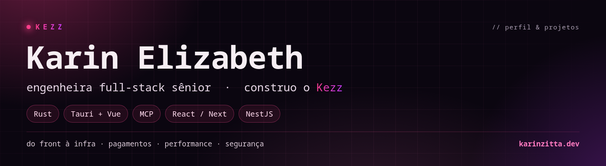

  

<h3 align="center">engenheira full-stack sênior · construo o <b>Kezz</b></h3>

  
  
  

---

Cinco anos escrevendo software que vai pra produção — do front à infra. Gosto de sistema que aguenta tráfego de verdade, pagamento que não falha e código que outra pessoa consegue continuar.

### 🛠 Em construção: Kezz

O **Kezz** nasceu de um incômodo: a IA estava presa num lugar só. É um ecossistema onde a IA é a integração e trabalha por mim.

- **Kezz Board** — fala MCP. A IA cria nota, tarefa, coluna, cartão e seta sozinha.
- **Servidor em Rust** — conta, sessão, sync e deploy.
- **DNS e ameaças** — servidor próprio alimentando o dashboard.
- **Fala com todos os apps** — memória, ferramentas, e me avisa no chat quando termina trabalho autônomo. Controla o telefone e os notebooks.

Stack: **Rust · Tauri + Vue · MCP · SQLite**.

### stack

  
  
  
  
  
  
  
  
  
  
  
  

### em que sou boa

`APIs e arquitetura` · `front-end` · `pagamentos` · `performance` · `segurança` · `infra`

---

// <b>karinzitta.dev</b> · Londrina, PR — Brasil

